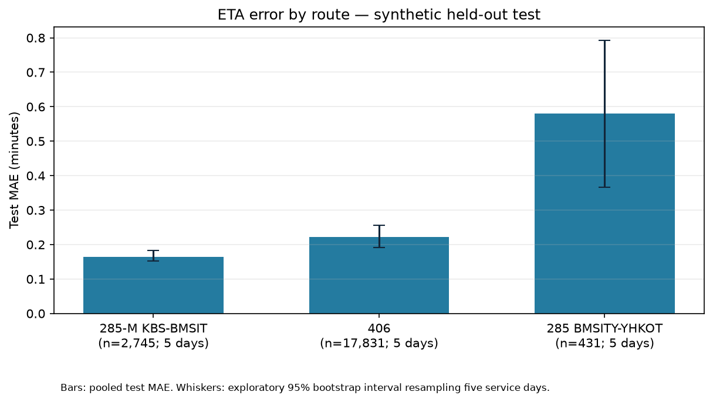
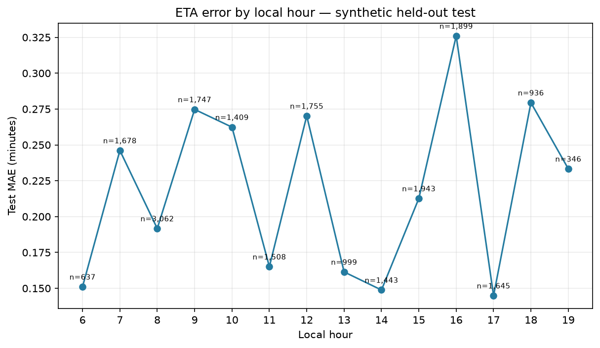
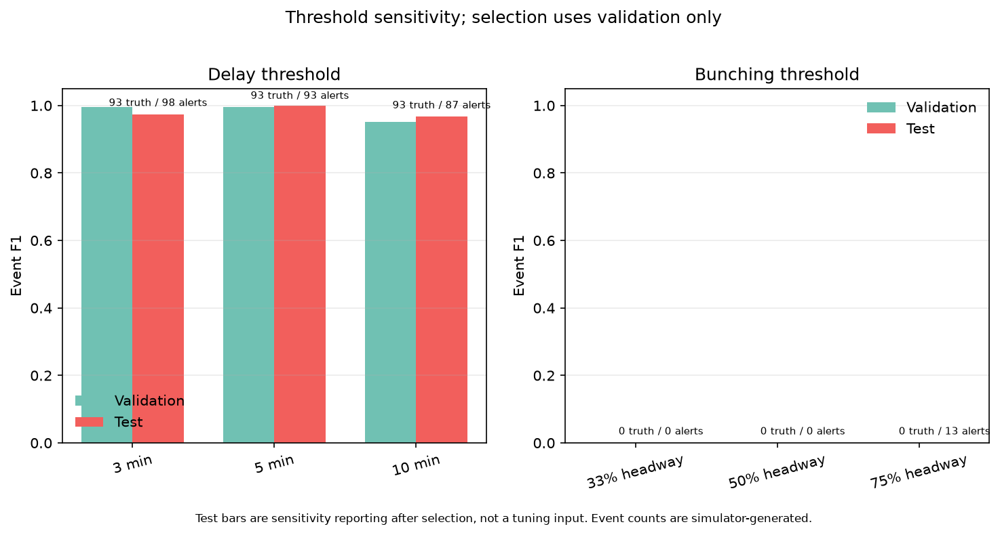

# carbonOrbit: Real-Time Bus Tracking and ETA Prediction for Sustainable Urban Mobility

**Final project report — corrected synthetic evaluation**

**Report date:** 21 November 2026

**Repository state:** see release baseline and evidence package; report content tied to run `88d1eb4fc1efd6c1`

**Evidence status:** reproducible simulation study; not a field evaluation of BMTC operations

## Abstract

This project builds a reproducible pipeline for bus arrival-time estimation and delay/bunching alerts using three selected Bengaluru Metropolitan Transport Corporation (BMTC) routes as geographic and timetable context. The source is a pinned, community-maintained GTFS archive; it is not an official live feed. To evaluate the pipeline when observed BMTC vehicle positions are unavailable, the project generates seeded synthetic bus trajectories, observation noise, data dropout, and independent event labels. A chronological 18/5/5-day train/validation/test split is used to compare historical, moving-speed, Ridge, Random Forest, and Gradient Boosting ETA models.

On the held-out synthetic test block, the validation-selected Random Forest achieved an ETA mean absolute error (MAE) of 0.2217 minutes and root mean squared error (RMSE) of 0.6452 minutes over 21,007 predictions. Its MAE was 75.1% lower than the historical-mean baseline and 26.2% lower than Ridge. After correcting the event evaluation to use fixed truth labels and trip-level delay matching, delay detection reached F1 0.974. Bunching could not be evaluated because no positive validation or test events were generated under the frozen 50% headway rule. A noisy-GPS perturbation increased ETA MAE to 0.2446 minutes, while high dropout produced 0.2236 minutes. These are results under the simulator’s assumptions and do not establish actual BMTC accuracy or prevalence. The emissions module is implemented as a separate scenario interface, but no compatible, project-approved factors or diversion observations were available; this report therefore makes no numerical emissions-reduction claim.

## 1. Introduction

Bus arrival uncertainty and irregular headways can make public transport harder to plan around. Published studies show that real-time information can improve the passenger information experience, and some city-level studies estimate ridership changes after information-system deployments. Those findings are context-specific and do not demonstrate that an ETA application causes mode shift in Bengaluru. Likewise, accurate ETA prediction alone does not measure service reliability, prevent bunching, or prove an environmental benefit.

This project addresses a narrower engineering and evaluation problem: can an auditable pipeline generate bus telemetry for selected BMTC routes, compare ETA methods without future-information leakage, detect defined reliability events against known labels, and expose the results through an API and dashboard? The current experiment answers this question using synthetic operations anchored to published route geometry and schedules. Its output is a reproducible evaluation of the specified simulator, not evidence from BMTC vehicles.

### 1.1 Research question

How well do pre-specified ETA methods predict stop arrivals, and how reliably can delay and bunching events be detected, on reproducibly simulated service using selected BMTC routes—and how sensitive are explicitly bounded emissions scenarios to their assumptions?

### 1.2 Objectives

1. Audit a reproducible GTFS source and select three routes using a recorded, proximity- and usability-based rule.
2. Generate seeded synthetic positions, delays, dwell, GPS noise, dropout, and separate event ground truth.
3. Compare ETA baselines and machine-learning models using chronological data partitions and common metrics.
4. Score delay and bunching detection against simulator labels using event precision, recall, and F1.
5. Keep any environmental calculation conditional on explicit, source-attributed inputs and separate from ETA metrics.
6. Provide a local API/dashboard and reproducibility documentation without representing simulated service as live BMTC data.

### 1.3 Contribution and scope

The contribution is a reproducible BMTC-route simulation and evaluation workflow combining ETA model comparison, event-level reliability detection, and an independently bounded emissions-scenario interface. Prior work already connects ETA prediction with bunching control [12], and separate work combines bus-delay prediction with CO₂ estimation [19]. This project does not claim a new ETA algorithm, the first integrated prediction system, real-world BMTC validation, causal ridership effects, or observed emissions savings.

## 2. Related work

The literature survey is a focused narrative synthesis, not a systematic review. The full paper notes and the detailed publisher/repository citation audit are maintained separately in [`../literature_survey.md`](../literature_survey.md) and [`../citation_audit.md`](../citation_audit.md). The main methodological implications are summarized here.

### 2.1 ETA prediction

BusTime compares statistical and machine-learning approaches on Dublin GPS data and emphasizes that accuracy, computation, and practical deployment must be considered together [1]. Taparia’s Dublin thesis provides a precedent for historical and regression baselines; its reported MAEs differ between a results table and nearby prose, so the table values and discrepancy are retained rather than silently reconciled [2]. Bhutani et al. evaluate a sequence-to-sequence recurrent model using real transit data [3]. These studies support common targets, simple baselines, chronological validation, and transparent metrics; their rankings are not predictions of performance on carbonOrbit’s synthetic routes.

The 2025 ETA review is bibliographically identified, but the team’s available copy was abstract/record-level; it is not used here for detailed full-text claims [4]. A separate 2025 paper on data-constrained bus travel-time prediction and an Astana GPS-to-GTFS dataset are distinct works and should not be conflated [5, 6].

### 2.2 Reliability and passenger response

GTFS-Realtime has been used to classify and measure transit delay variation [7]. Bunching research includes predictive control and reviews of operational approaches [8–11]. Rawat et al. combine bus arrival prediction with a simulated multi-agent bunching-prevention strategy [12]. Therefore carbonOrbit’s work is limited to detecting its defined synthetic events; it does not implement or evaluate preventive control.

Studies of real-time information report context-dependent passenger outcomes. A New York natural experiment found an average weekday route-level ridership increase, concentrated more strongly on larger routes [13]. The Tampa experiment reported improved waiting perceptions but did not find an increase in bus-trip frequency during its study [14]. These results do not establish modal diversion, car replacement, or Bengaluru-specific outcomes. CarbonOrbit has no passenger response data, so no ridership or causal emissions claim follows from its ETA scores.

### 2.3 Emissions context

Indian transport inventories and scenario reports provide context but are not interchangeable operational factors for the selected BMTC services [15–18]. In particular, lifecycle estimates must not be mixed with tailpipe-only factors, and Delhi per-passenger comparisons cannot be transferred directly to Bengaluru. The project’s emissions calculator is therefore treated as a scenario interface: any future numeric result must name the pollutant, system boundary, geography, year, unit, occupancy, service response, and displaced mode. In the current run, factors remain unset and no numerical environmental outcome is reported.

## 3. Data and study setting

### 3.1 GTFS source and route selection

The study uses the Vonter community BMTC GTFS snapshot at commit `a4702664d65bfbb37290a5f75effaa24ead1d9dd`. The raw archive is kept locally and is not included in the repository. Its SHA-256 is `812c7d472ff116024ca1e0a7ff6e28662f762ca09265da8d5c7e9f6241cf8a45`; the archive has 12 GTFS text files. Project-level integrity checks found unique route, stop, and trip identifiers, valid stop-time references, positive stop sequences, and resolvable trip shape references. These checks are not a certification by an official GTFS validator.

The data source is unofficial, derived from Namma BMTC 2.0, and warns that schedules/stop times may be inaccurate, arrivals may be interpolated, and some routes, stops, or timetables may be missing. The official DULT portal could not be verified during the audit because it returned a gateway error. The three selected route IDs are `BMTC:dd9ea3794c96` (285-M KBS–BMSIT), `BMTC:6f4d45186ddd` (285 BMSITY–YHKOT), and `BMTC:b202977c0fc0` (406). The route selection and source audit are documented in [`../data_sources.md`](../data_sources.md).

The GTFS supplies route geometry, stop order, and schedule context only. It is not a live vehicle-position feed and is not treated as operational ground truth.

### 3.2 Synthetic observations and labels

Vehicle identifiers, timestamped positions, speed observations, dwell, delay, GPS noise, message dropout, arrivals, and reliability labels are generated by the simulator. Ground-truth labels are kept separate from model feature inputs. The normal run generated 117,713 telemetry pings/ETA labels, 24,760 ground-truth stop arrivals, 24,051 noisy stop observations, 535 delay/bunching event labels, and 3,599 quality-log rows. These counts describe generated records, not real vehicles or service events.

No passenger-level or personally identifying data are used. There are no observed passenger counts, private-vehicle substitutions, or user responses in this experiment.

## 4. System design

The pipeline has six components:

1. **GTFS loader:** reads the pinned local archive, checks its checksum and required files, and extracts the audited route schedules, stops, and shapes.
2. **Simulator:** produces seeded synthetic service trajectories, observed pings, stop observations, independent event labels, data-quality records, and a run manifest.
3. **Analytics:** constructs prediction-time features, trains model candidates, selects using validation data, scores the held-out test block, and evaluates event alerts.
4. **Emissions scenario interface:** accepts explicit factor and activity assumptions; it does not infer passenger diversion from ETA quality. No factors were active in this run.
5. **Flask API and SQLite:** serve simulated bus, ETA, alert, and summary information from local generated artifacts.
6. **Dashboard:** displays the locally served simulated fleet, ETAs, alerts, and evaluation summary. It is not connected to BMTC operations.

The API/database pipeline ran with generated outputs. A manual browser review showed 22 buses, 100 alerts, Random Forest and the 0.22-minute test MAE. These are dashboard display values from the demo database and do not represent a live count or independent evaluation.

## 5. Methodology

### 5.1 Simulation and reproducibility

The evaluation run is `88d1eb4fc1efd6c1`, generated 20 November 2026 from the pinned archive and configured seed. It covers 28 simulated service days, 9 November through 6 December 2026. Repeating the normal simulation with the same configuration produced identical output-file checksums. Generated full-size data and evaluation outputs remain in ignored local directories; they can be recreated with `venv\\Scripts\\python.exe scripts\\carbonorbit.py suite` from the repository root.

### 5.2 Chronological split

Service days were kept in chronological blocks to reduce leakage between adjacent observations:

| Partition | Dates | Days | Role |
|---|---|---:|---|
| Train | 9–26 Nov 2026 | 18 | Fit model parameters and training-derived transformations |
| Validation | 27 Nov–1 Dec 2026 | 5 | Select model and event thresholds |
| Test | 2–6 Dec 2026 | 5 | Final held-out scoring |

The selected model and alert thresholds were fixed using training/validation data, then evaluated on the test block.

Leakage review of `src/carbonorbit/analytics.py` confirmed the partition sets are chronological and disjoint; candidate selection and event-threshold selection use validation metrics; model refitting uses train plus validation before predicting test rows. Test labels are only used for final scoring and sensitivity reporting. The corrected simulator speed feature uses scheduled speed plus independent observation variation and observed-coordinate remaining distance, rather than realized future travel duration or hidden simulator progress. This review covers the recorded code path and synthetic schema; it does not establish validity on real AVL data.

### 5.3 ETA models and metrics

The candidate ladder comprised HistoricalMean, MovingSpeed, Ridge, RandomForest, and GradientBoosting. Candidates were evaluated on common held-out target rows using MAE, RMSE, and the fraction of predictions within two minutes. The project’s parsimony/validation selection rule selected RandomForest. The ETA target is time remaining to the downstream stop, in minutes.

An early, invalid experiment used realized future segment duration in the speed feature, resulting in implausibly low errors. That run is excluded. The simulator was corrected to derive speed from scheduled leg speed with independent observation variation and to calculate remaining distance from the GPS-perturbed observed coordinate rather than hidden simulator progress. A final-ping target-rounding edge case was also corrected to preserve positive valid horizons. The metrics reported below are from the corrected run.

### 5.4 Event definitions and scoring

An implementation audit found that the original threshold sweep changed truth labels along with detector settings. This made F1 values across thresholds incomparable. The corrected implementation fixes truth at the predeclared rules (delay >=5 minutes; bunching <=50% of scheduled headway) and varies detector thresholds only. Delay events are matched by route, trip, and service date, consistent with their trip-level labels; bunching uses same-route/same-stop matching within 30 seconds. Threshold selection uses validation only; if validation has no positive truth events, the configured default is retained without claiming the detector was evaluated.

Under the corrected protocol, the 50% bunching rule generated no positive events in validation or test, so the bunching task is unscorable on this run. No looser threshold is substituted as ground truth. The project also does not define a finite set of negative event opportunities, so true negatives, specificity, and event accuracy are not reported.

### 5.5 Robustness scenarios

The normal-run RandomForest and event thresholds were applied without retuning to noisy-GPS (25 m standard deviation) and high-dropout (15%) simulations. These are controlled perturbations to the simulator, not empirical estimates of BMTC GPS quality or message loss.

### 5.6 Emissions calculation boundary

The conceptual calculation compares displaced private-mode passenger-kilometres with any incremental bus-service passenger-kilometres, multiplied by compatible emission factors. A valid report would need sourced factors with matching pollutant, geography, year, unit, and lifecycle/tailpipe boundary, and explicit occupancy, trip distance, diversion, and service assumptions. Since those inputs were not populated and passenger diversion is unobserved, this report provides no emissions number or reduction result.

## 6. Results

### 6.1 ETA performance

| Model | Test MAE (min) | Test RMSE (min) | Within 2 min |
|---|---:|---:|---:|
| HistoricalMean | 0.8907 | 1.2997 | 91.73% |
| MovingSpeed | 0.3595 | 0.8049 | 97.72% |
| Ridge | 0.3005 | 0.7828 | 98.52% |
| RandomForest (selected) | **0.2217** | **0.6452** | **98.86%** |
| GradientBoosting | 0.2636 | 0.7141 | 98.51% |

There were 21,007 test predictions. The selected model’s MAE was 75.1% lower than HistoricalMean and 26.2% lower than Ridge on this test block. By route, RandomForest MAE/sample count was 0.5805 minutes/431 for `BMTC:6f4d45186ddd`, 0.2220/17,831 for `BMTC:b202977c0fc0`, and 0.1638/2,745 for `BMTC:dd9ea3794c96`. The aggregate is dominated by route `BMTC:b202977c0fc0`, while the first route’s much smaller sample makes its estimate less stable.

### 6.2 Event detection

| Event | Selected rule | Validation F1 | Test TP / FP / FN | Test precision | Test recall | Test F1 |
|---|---|---:|---:|---:|---:|---:|
| Delay | 3 minutes | 0.995 | 93 / 5 / 0 | 0.949 | 1.000 | 0.974 |
| Bunching | 50% configured default (no validation positives) | not scorable | 0 / 0 / 0 | not scorable | not scorable | not scorable |

Delay detection exceeds the proposed 0.90 test F1 target on this synthetic split. Bunching performance cannot be assessed because there are no positive examples under the frozen truth rule. These results are simulator-dependent and are not field detection rates.

### 6.3 Robustness

| Scenario | Test predictions | ETA MAE (min) | Delay F1 at normal-selected 3-minute detector threshold | Bunching F1 |
|---|---:|---:|---:|---:|
| Normal | 21,007 | 0.2217 | 0.974 | not scorable (0 truth events) |
| Noisy GPS (25 m std. dev.) | 21,007 | 0.2446 | 0.974 | not scorable (0 truth events) |
| High dropout (15%) | 18,915 | 0.2236 | 0.974 | not scorable (0 truth events) |

The same model and thresholds selected on normal validation data were used across scenarios. Delay labels and alerts were matched by trip identity. Bunching remains unscorable because no positive truth events were generated. These results only quantify the chosen simulated perturbations.

Route-level MAE uncertainty was estimated by resampling the five held-out days as clusters (10,000 bootstrap draws). The 95% intervals were 0.3664–0.7921 minutes for 285 BMSITY-YHKOT, 0.1915–0.2555 for 406, and 0.1529–0.1836 for 285-M KBS-BMSIT. These intervals reflect only day-to-day variation in this five-day simulated test block. Route/hour tables and visualizations are available in [`evidence/88d1eb4fc1efd6c1/`](evidence/88d1eb4fc1efd6c1/).

With the fixed 5-minute delay truth rule, descriptive test F1 was 0.974, 1.000, and 0.967 at detector thresholds of 3, 5, and 10 minutes. The 3-minute threshold was selected on validation; test sensitivity did not select the operating setting. Bunching test sensitivity is not interpretable because the frozen truth rule has zero positive cases.

### 6.4 Emissions

No numeric emissions result is available. Factor values and observed passenger diversion are absent; presenting a carbon or pollutant reduction would require assumptions not supported by this run.

## 7. Discussion

Within the corrected synthetic dataset, the tree-based candidates improve substantially on the historical baseline, and RandomForest is the best of the evaluated models under the recorded validation selection rule. This demonstrates that the pipeline can distinguish candidates under one deterministic simulator configuration. It does not establish that the model will perform similarly on real vehicle traces, under actual traffic conditions, or on other BMTC routes.

Event detection evidence is incomplete. Delay detection met the proposed test F1 target in the synthetic run, but the score is tied to the simulator's persistent trip delays and simple threshold logic. Bunching remains untested because the frozen rule produced no positive examples. Future work should add independently reviewed, operationally plausible bunching examples and evaluate against observed vehicle positions before operational interpretation.

The error distribution also reflects route imbalance. One route provides most test examples, while another has only 431. A single aggregate metric can conceal route-specific differences; future comparisons should add route-balanced summaries and uncertainty intervals. The current report gives route subgroup MAE and counts but does not claim statistical precision from the synthetic sample alone.

The project’s broader sustainability motivation remains a hypothesis, not a measured outcome. Literature on real-time passenger information provides evidence about waiting experience and, in some contexts, ridership. It does not supply a local diversion rate. An environmental scenario analysis should only be added after source-compatible factors and explicit, clearly labeled service and diversion assumptions have been selected; ideally, passenger behavior would be studied directly.

## 8. Limitations

1. **No real-time BMTC trajectories:** all vehicle movements, delays, noise/dropout patterns, and event labels are generated.
2. **Unofficial schedule context:** the community GTFS has documented caveats; the official DULT feed and licence were not verified.
3. **Simulator dependence:** model ranking and event scores depend on the chosen synthetic data-generating process and seed/configuration.
4. **Route imbalance:** one route dominates the aggregate ETA sample; one route has a small test count.
5. **Limited event evidence:** test positives are few, negative event opportunities are not defined, and no TN/specificity can be calculated.
6. **No observed passenger response:** no measured wait experience, ridership change, mode substitution, or passenger-kilometres are available.
7. **No emissions estimate:** compatible factors and approved scenario inputs have not been populated; no CO₂e or particulate reduction is established.
8. **No external-city or operational validation:** the run does not transfer-test to another network or to actual BMTC service.

## 9. Conclusion and next research steps

The project has produced a reproducible synthetic evaluation workflow for ETA prediction and reliability-event detection on three selected BMTC route geometries. On the held-out simulation, RandomForest achieved 0.2217-minute MAE over 21,007 predictions. Corrected delay detection reached F1 0.974; bunching could not be evaluated because there were zero positive truth events under the frozen rule. The pipeline and dashboard display generated data, not live bus operations. The evidence supports a software/simulation proof of concept only.

The next research steps are to obtain and document an authorized, stable BMTC GTFS source; collect or access real vehicle-position and schedule-adherence observations for independent validation; balance route coverage; predefine event negatives and evaluate thresholds on larger held-out samples; and separately validate any emissions factors and passenger-diversion assumptions before publishing scenario outputs. The evaluation should be rerun after those data and protocol changes, with the synthetic and observed results clearly separated.

## Appendix A. Reproduction record

- Run identifier: `88d1eb4fc1efd6c1`
- GTFS commit: `a4702664d65bfbb37290a5f75effaa24ead1d9dd`
- GTFS archive SHA-256: `812c7d472ff116024ca1e0a7ff6e28662f762ca09265da8d5c7e9f6241cf8a45`
- Simulated period: 2026-11-09 to 2026-12-06
- Split: 18 train days / 5 validation days / 5 test days
- Main command: `venv\\Scripts\\python.exe scripts\\carbonorbit.py suite`
- Results summary: [`../simulation_results.md`](../simulation_results.md)
- Data source and route audit: [`../data_sources.md`](../data_sources.md)
- Evaluation protocol: [`../evaluation_plan.md`](../evaluation_plan.md)
- Citation audit: [`../citation_audit.md`](../citation_audit.md)
- Release baseline and clean-environment instructions: [`../release_baseline.md`](../release_baseline.md)
- Compact evidence, figures, sensitivity, and reproducibility/latency checks: [`evidence/88d1eb4fc1efd6c1/`](evidence/88d1eb4fc1efd6c1/)

## References

Bibliographic records, access boundaries, and field-by-field verification status are documented in [`../citation_audit.md`](../citation_audit.md). Access date for online records checked in this report: 20 November 2026.

1. Liu, D., Sun, J., & Wang, S. (2020). “BusTime: Which is the Right Prediction Model for My Bus Arrival Time?” arXiv:2003.10373. https://arxiv.org/abs/2003.10373
2. Taparia, A. (2020). *Bus Journey and Arrival Time Prediction based on Archived AVL/GPS data using Machine Learning.* MSc dissertation, Trinity College Dublin. https://publications.scss.tcd.ie/theses/diss/2020/TCD-SCSS-DISSERTATION-2020-078.pdf
3. Bhutani, N., Pachal, S., & Achar, A. (2022; v2, 2024). “Public Transit Arrival Prediction: a Seq2Seq RNN Approach.” arXiv:2210.01655. https://arxiv.org/abs/2210.01655
4. Kumar, B. A. et al. (2025). “Bus Arrival Time Prediction: A Comprehensive Review.” *IEEE Transactions on Intelligent Transportation Systems*, 26(6), 7362–7379. https://doi.org/10.1109/TITS.2025.3545695
5. Rakhimzhanov, D., & Mansurova, A. (2025). “Bus Travel Time Prediction Under Data Constraints: A Lightweight Deep Learning Approach.” Proceedings of ICCIKE 2025, 444–449. https://doi.org/10.1109/ICCIKE67021.2025.11318207
6. Mansurova, A., Mussina, A., Aubakirov, S., Nugumanova, A., & Yedilkhan, D. (2025). “From Raw GPS to GTFS: A Real-World Open Dataset for Bus Travel Time Prediction.” *Data*, 10(8), 119. https://doi.org/10.3390/data10080119
7. Aemmer, Z., Ranjbari, A., & MacKenzie, D. (2022). “Measurement and Classification of Transit Delays Using GTFS-RT Data.” *Public Transport*, 14(2), 263–285. https://doi.org/10.1007/s12469-022-00291-7
8. Andres, M., & Nair, R. (2017). “A Predictive-Control Framework to Address Bus Bunching.” *Transportation Research Part B: Methodological*, 104, 123–148. https://doi.org/10.1016/j.trb.2017.06.013
9. Rezazada, M., Nassir, N., & Tanin, E. (2022). “Public Transport Bunching: A Critical Review with Focus on Methods and Findings for Implications for Policy and Future Research.” Australasian Transport Research Forum. https://australasiantransportresearchforum.org.au/papers/?sdata=Public+transport
10. Rezazada, M., Nassir, N., Tanin, E., & Ceder, A. (2024). “Bus Bunching: A Comprehensive Review from Demand, Supply, and Decision-Making Perspectives.” *Transport Reviews*, 44(4), 766–790. https://doi.org/10.1080/01441647.2024.2313969
11. Yang, Y., Cheng, J., & Liu, Y. (2024). “An Overview of Solutions to the Bus Bunching Problem in Urban Bus Systems.” *Frontiers of Engineering Management*, 11, 661–675. https://doi.org/10.1007/s42524-024-0297-1
12. Rawat, S., Abaidullina, A., Alimbayeva, D., Kumar, D., & Kumar, P. (2026). “Real-Time Bus Arrival Prediction and Bus Bunching Prevention Using a Multi-Agent LSTM Approach.” *Frontiers in Built Environment*, 12. https://doi.org/10.3389/fbuil.2026.1894212
13. Brakewood, C., Macfarlane, G. S., & Watkins, K. (2015). “The Impact of Real-Time Information on Bus Ridership in New York City.” *Transportation Research Part C: Emerging Technologies*, 53, 59–75. https://doi.org/10.1016/j.trc.2015.01.021
14. Brakewood, C., Barbeau, S., & Watkins, K. (2014). “An Experiment Evaluating the Impacts of Real-Time Transit Information on Bus Riders in Tampa, Florida.” *Transportation Research Part A: Policy and Practice*, 69, 409–422. https://doi.org/10.1016/j.tra.2014.09.003
15. Ramachandra, T. V., & Shwetmala. (2009). “Emissions from India's transport sector: Statewise synthesis.” *Atmospheric Environment*, 43(34), 5510–5517. https://doi.org/10.1016/j.atmosenv.2009.07.015
16. International Transport Forum. (2023). *Life-cycle Assessment of Passenger Transport: An Indian Case Study.* https://doi.org/10.1787/2d11e416-en
17. Ananthakumar, M. R., & Paladugula, A. L. (2017). *Impact of Decarbonisation Strategies on Road Transport Sector Emissions.* GHG Platform India, Phase II. https://ghgplatform-india.org/wp-content/uploads/publications/phase-2/GHGPI-PhaseII-Decarbonisation%20Impact%20on%20Road%20Transport%20Sector%20Emissions-Oct17.pdf
18. Wills, W., Meirelles, J., Baptista, V. G., Cury, G., & Cerdeira, P. (2019). “A Simple Sinuosity-Based Method using GPS Data to Support Mitigation Policies for Public Buses GHG Emissions.” arXiv:1907.09335. https://arxiv.org/abs/1907.09335
19. Amogha, B. V., Bairy, P. R., Selvam, S., & Joy, J. D. (2026). “Machine Learning-Based Prediction of Bus Delay and CO2 Emission Estimation Using XGBoost.” In *Data Science and Applications (ICDSA 2025)*, *Lecture Notes in Networks and Systems*, 1795, 216–227. https://doi.org/10.1007/978-3-032-15404-0_19. Publisher abstract only; detailed claims require chapter access.
20. Ganesh et al. (2012). “Implementation of a Real Time Passenger Information System.” arXiv:1206.0447. https://arxiv.org/abs/1206.0447. Journal venue metadata was not independently confirmed in this audit.
