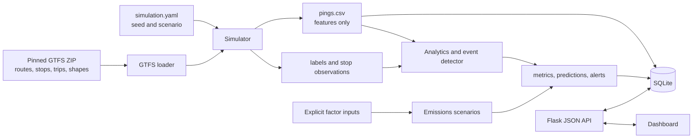

# carbonOrbit System Architecture

**Status:** Implementation contract, prepared for team review.
**Data boundary:** GTFS supplies route geometry and schedule context; bus movement, pings, and event labels are synthetic.

## Components

1. **GTFS loader** reads the pinned archive from `data/raw/`, validates required files, and extracts the audited routes, trips, stop sequences, schedules, and shapes.
2. **Simulator** uses a fixed seed and YAML configuration to emit telemetry pings, stop observations, ETA targets, event labels, data-quality events, and a run manifest. Labels are kept in a separate file from model features.
3. **Analytics** builds prediction-time features, fits the declared baseline/model ladder on chronological service-day partitions, selects with validation data, and reports test metrics once.
4. **Emissions scenario calculator** accepts explicit source-attributed inputs. It does not infer passenger diversion from ETA quality and rejects missing or incompatible factors.
5. **Flask API and SQLite store** load generated outputs and expose current simulated buses, stored ETA predictions, detector alerts, and summary metrics.
6. **Dashboard** polls the API and renders route positions, ETA records, alerts, and evaluation summaries. It is a visualization of simulated project data, not a live BMTC feed.

## Data flow

## Runtime boundaries

- Raw GTFS stays in ignored `data/raw/`; never commit it. The manifest records the pinned revision and archive checksum from `docs/data_sources.md`.
- Generated files are reproducible artifacts and remain in ignored `data/simulated/` or `results/` unless a small derived artifact is explicitly approved for the repository.
- The model feature table must not contain simulator labels, realized future arrivals, or future pings.
- API responses identify the simulation run and return empty prediction/alert lists when the matching analysis artifact is not available.
- SQLite is a local demo store; it is not a multi-user production database.
